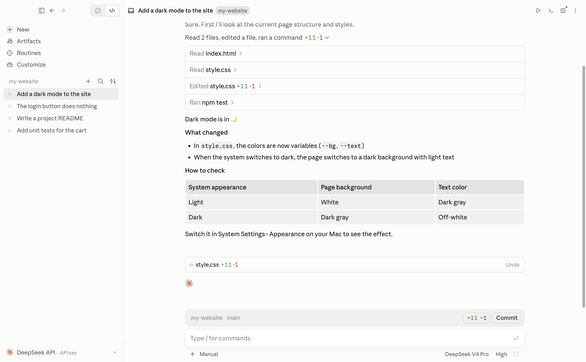
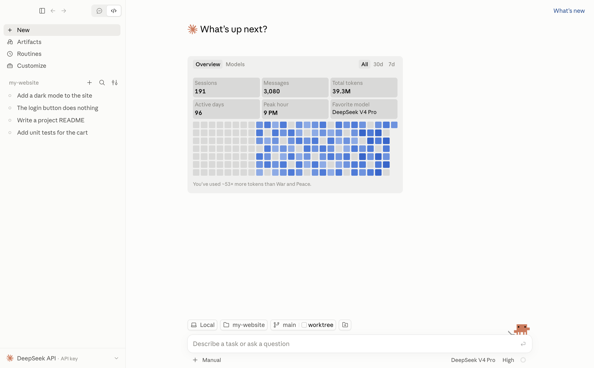
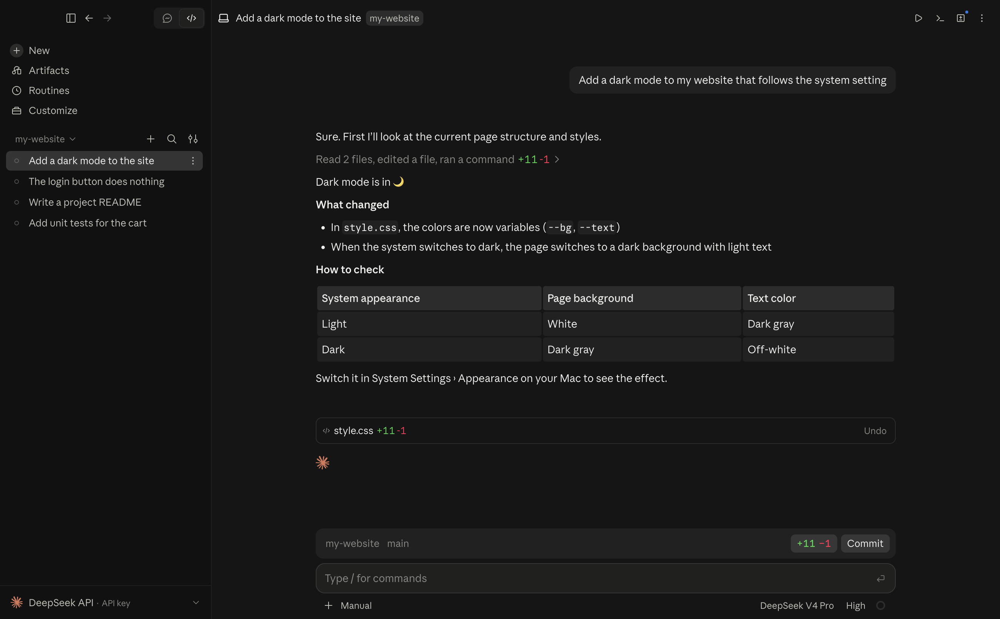
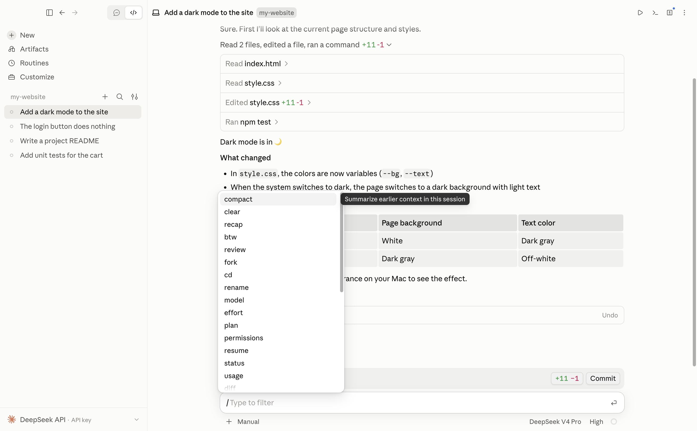
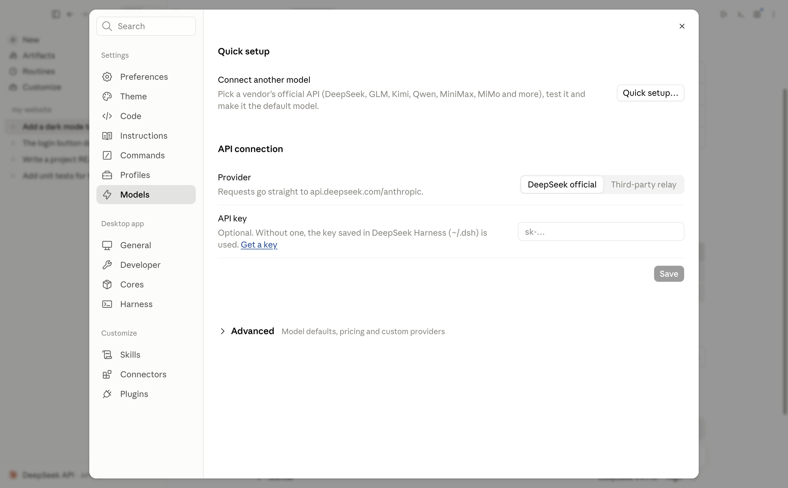
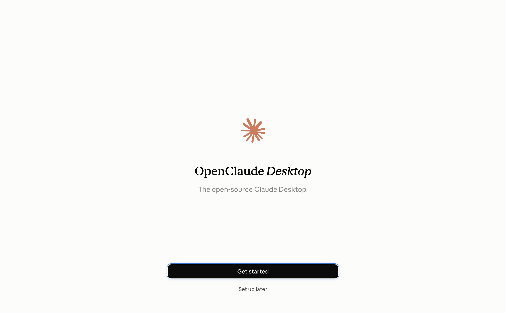

<div align="center">

# OpenClaude Desktop

### The open-source "Claude Desktop"

**The Claude interface you already know. Except this time, you're in charge.**

Which AI runs it, what you pay, how it talks, how it looks: all up to you.


[](LICENSE)

[Quick start](#before-you-start) · [Tour](#a-quick-tour) · [FAQ](#faq) · [简体中文](README.md)

<br>

<picture>
  <source media="(prefers-color-scheme: dark)" srcset="docs/images/session-dark-en.png">
  
</picture>

<sub>↑ Asked to "add a dark mode to my website": it read 2 files, edited 1, ran the tests, then explained what changed and how to check it.</sub>

</div>

<br>

## Your Claude Desktop, not Anthropic's

Claude Desktop's interface is great: clear conversations, every step visible, every change easy to review. But it only runs Claude, it needs a subscription, and Anthropic sets the rules.

**OpenClaude Desktop puts that same interface in your hands.** The AI underneath is the one you pick (DeepSeek by default). You pay the provider you chose for what you use. The system prompt, permissions, appearance and even the source code are yours to change.

| | Official Claude Desktop | **OpenClaude Desktop** |
|---|---|---|
| Interface | The Claude interface | **The same Claude interface** |
| Which AI | Claude only | **DeepSeek, Codex, any OpenAI-compatible relay or self-hosted model** |
| Account | Claude account and subscription | **No sign-up. Just your own API key** |
| Pricing | Monthly subscription | **Pay-as-you-go to the provider you choose; can be very cheap** |
| How the AI talks | Built-in system prompt | **Replace the whole system prompt, and set instructions per project** |
| Appearance | Fixed | **Theme, colors, fonts, assistant name and avatar** |
| Source code | Closed | **Open source. Change anything** |
| Your data | Sent to Anthropic | **Sent only to the provider you choose; settings and history stay on your Mac** |
| Transparency | Not transparent | **Open Source Code** |


---

## What it does

Tell it what you want in plain English (or Chinese): "add a dark mode to this page", "what does this error mean?". It reads your project, edits code and runs commands, showing you every step and asking first when it needs to.

- 💬 **Code by chatting**: open a project folder and describe what you need. It reads files, edits code and runs tests.
- 🔒 **You set the permissions**: have it ask before editing files or running commands. Switch modes any time.
- 🗂️ **Many sessions**: manage every conversation in the sidebar. Pin, group, archive, or view two side by side.
- 🖥️ **Built-in terminal and preview**: see terminal output, diffs and a web preview without leaving the window.
- 🌏 **English and Simplified Chinese**: switch the interface language in Settings.
- 🔌 **Switching AI is easy**: DeepSeek's official API, third-party relays, self-hosted servers, or Codex.
- 🎨 **Customize everything**: system prompt, theme colors, assistant name and avatar, custom slash commands.

---

## A quick tour

<table>
  <tr>
    <td width="50%" valign="top">
      
      <p align="center"><b>Home</b><br><sub>All your sessions on the left, your usage at a glance</sub></p>
    </td>
    <td width="50%" valign="top">
      
      <p align="center"><b>Dark mode</b><br><sub>Follows your system appearance automatically</sub></p>
    </td>
  </tr>
  <tr>
    <td width="50%" valign="top">
      
      <p align="center"><b>Slash commands</b><br><sub>Type <code>/</code> to find every action. Nothing to memorize</sub></p>
    </td>
    <td width="50%" valign="top">
      
      <p align="center"><b>Models and keys</b><br><sub>DeepSeek official, third-party relays and more providers</sub></p>
    </td>
  </tr>
</table>

---

## Before you start

| You need | Notes |
|---|---|
| A Mac with Apple silicon | M1, M2, M3 or M4. Intel Macs, Windows and Linux aren't supported yet. |
| Node.js 22.19 or newer | The AI core runs on it. See below. |
| An API key for an AI provider | [DeepSeek](https://platform.deepseek.com/api_keys) is recommended (a few dollars of credit lasts a long time), or the URL and key of a relay you already use. |

### Install Node.js (once)

1. Open **Terminal** (search for "Terminal" in Spotlight or Launchpad).
2. If you don't have [Homebrew](https://brew.sh) yet, install it with the one-line command on its website.
3. Install Node.js:

```bash
brew install node
```

4. Check the version. `v22.19` or higher means you're set:

```bash
node -v
```

---

## Install OpenClaude Desktop

> There's no ready-made download yet, so you build the app from source once. Copy and paste the steps below; it takes about 5–10 minutes.

**Step 1: Get the source code**

```bash
git clone https://github.com/oleyyu/OpenClaudeDesktop.git
```

**Step 2: Install the AI core's dependencies**

```bash
cd OpenClaudeDesktop/harness && npm install
```

**Step 3: Install the app's dependencies**

```bash
cd ../app && npm install
```

**Step 4: Build the Mac app**

```bash
npm run package
```

The app is written to `OpenClaudeDesktop/releases/OpenClaude Desktop-darwin-arm64/`. Drag **OpenClaude Desktop.app** into your Applications folder and open it like any other app.

> ⚠️ Building needs the `reference/` UI assets (fonts, icons and so on), which aren't in this repository. If step 4 says it can't find files under `reference/...`, contact the project's author.
>
> 💡 If `npm install` is very slow (for example in mainland China), switch to a mirror first:
> ```bash
> npm config set registry https://registry.npmmirror.com
> ```

**Just want to try it?** You can run it without building the app (after step 3):

```bash
npm run build && npm start
```

---

## First launch

A setup screen opens. Click **Get started**:

<p align="center"></p>

Then follow the prompts:

1. **Choose your agent**: pick **DeepSeek** (recommended). To use Codex instead, pick Codex, then download it and sign in with your ChatGPT account when asked.
2. **Connect a model**:
   - DeepSeek's official API: choose **Official API** and paste your API key. No key yet? Click **Get a key**.
   - A relay or your own server: choose **Any endpoint**, enter the **API base URL** and **API key** it gave you, click **Fetch models** and pick a model.
3. Finish, and you're ready.

To switch the interface to Chinese: press `⌘ ,` (or choose OpenClaude Desktop › Settings… in the menu bar), then **Language** › **简体中文**.

To change your key or model, or add a relay later, go to **Settings › Models**.

---

## Everyday use

1. **Start a session**: click **New** in the top left and pick the project folder you want to work on.
2. **Describe what you want**: type in plain language at the bottom and press Return. You can drag images and files into the message box.
3. **Watch it work**: it shows each file it read, each change it made and each command it ran. Open the diff and terminal panes on the right.
4. **Interrupt any time**: click the stop button. You can also keep typing while it works; your messages queue up.

### Permission modes (below the message box)

| Mode | When to use it |
|---|---|
| **Manual** | Recommended to start. Asks before every file edit and command. |
| **Accept edits** | Trust it with file edits, but still asks before running commands. |
| **Plan** | Shows you a plan first and only acts once you approve. |
| **Auto** | Lets the AI decide what needs your approval. |
| **Bypass permissions** | Allows everything without asking. ⚠️ Only if you fully understand the risks. |

### Handy slash commands

Type `/` in the message box to see every command. The most useful:

| Command | What it does |
|---|---|
| `/clear` | Start over with a clean conversation (the old one is archived, not lost). |
| `/compact` | Summarize a long conversation to save context and cost. |
| `/model` | Switch to another model. |
| `/btw` | Ask a side question without interrupting the current task. |
| `/resume` | Bring back an earlier conversation. |
| `/review` | Have it review your code changes. |
| `/help` | See every command and keyboard shortcut. |

---

## FAQ

**It says "Add your DeepSeek API key"**
No key is set up yet. Use the button on the card, or add the key in Settings › Models.

**The AI never connects, or the core quits right away**
Usually Node.js is too old. Run `node -v` in Terminal; if it's below 22.19, run `brew upgrade node` and reopen the app.

**I can't reach DeepSeek (or another provider) from my network**
Add a relay you can reach in Settings › Models.

**How much does it cost?**
The app is free. You pay your AI provider for what you use (DeepSeek, for example, bills by usage). The **Usage** page in Settings shows what you've spent.

**Where is my data stored?**
On your own Mac:
- App settings: `~/Library/Application Support/code-desktop-local/`
- DeepSeek conversations and key: `~/.dsh/`

Nothing is uploaded anywhere except the conversation content sent to the AI provider you chose.

**How do I uninstall it?**
Drag the app to the Trash. To remove your data too, delete the two folders above.

---

## Project layout (for contributors)

```
OpenClaudeDesktop/
├── app/        The desktop app (Electron + React interface)
├── harness/    The AI core: connects DeepSeek Harness to the interface
├── docs/       Development log and technical notes
└── work/       Test scripts and verification records
```

- Run in development: `cd app && npm run build && npm start`
- Run the tests: `cd app && npm test`, `cd harness && npm test`
- Regenerate the README screenshots: `cd app && npx vite build && node scripts/readme-screenshots.mjs && README_LOCALE=en node scripts/readme-screenshots.mjs`
- Design and change history (mostly in Chinese): [docs/DEVELOPMENT-LOG.md](docs/DEVELOPMENT-LOG.md), [HANDOFF.md](HANDOFF.md), [harness/README.md](harness/README.md)

---

## License

[MIT](LICENSE): free to use, modify and distribute, including commercially, as long as you keep the copyright and license notice.

---

> **Disclaimer**: OpenClaude Desktop is an unofficial community project. It is not an Anthropic product and is not affiliated with or endorsed by Anthropic. "Claude" is a trademark of Anthropic, used here only to describe the style of the interface.
