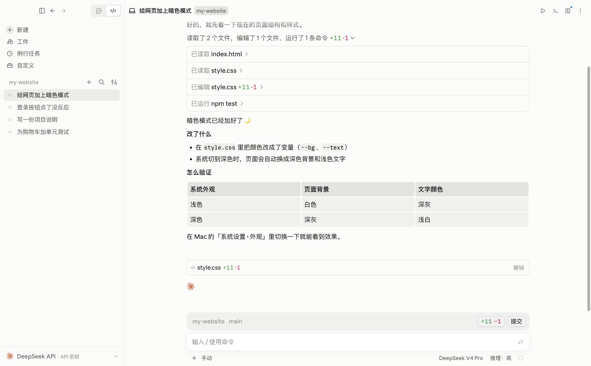
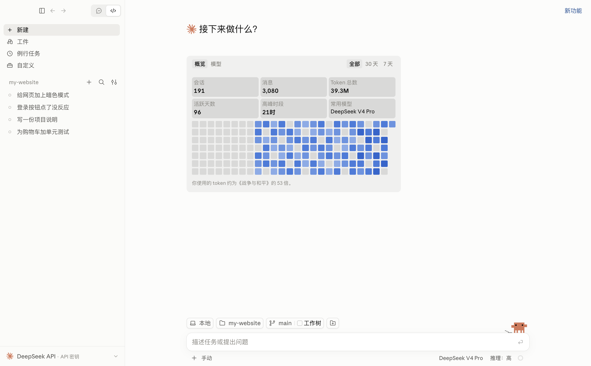
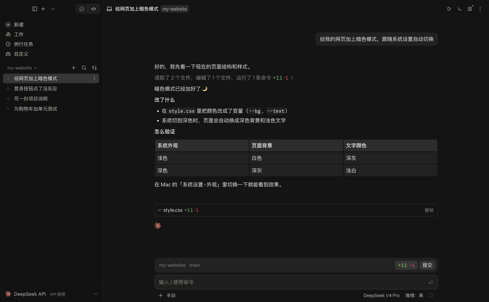
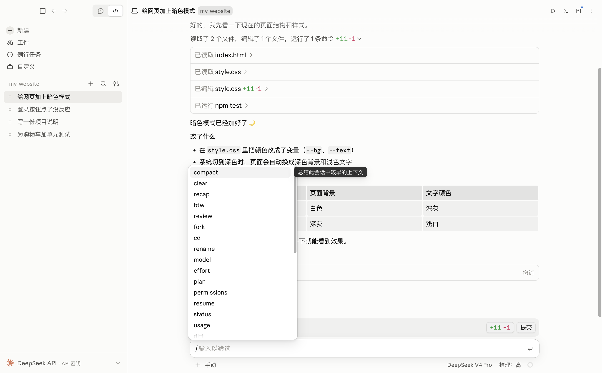
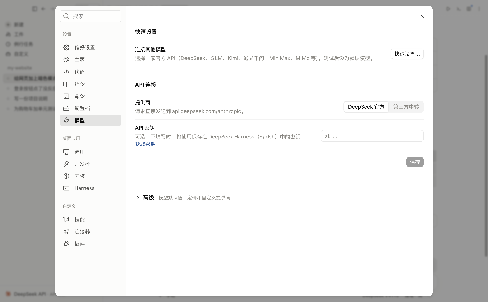
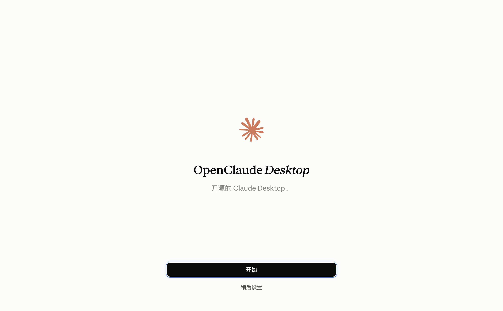

<div align="center">

# OpenClaude Desktop

### 开源的 “Claude Desktop”

**还是你熟悉的 Claude 界面。但这一次，由你说了算。**

用哪个 AI、花多少钱、它怎么说话、长什么样，全都你来定。


[快速开始](#使用前准备) · [界面一览](#界面一览) · [常见问题](#常见问题) · [English](#english)

<br>

<picture>
  <source media="(prefers-color-scheme: dark)" srcset="docs/images/session-dark.png">
  
</picture>

<sub>↑ 让它“给网页加上暗色模式”：读了 2 个文件、改了 1 个文件、跑了测试，最后用中文告诉你改了什么、怎么验证。</sub>

</div>

<br>

## 你的 Claude Desktop，不是 Anthropic 的

Claude Desktop 的界面很好用：对话清楚、每一步都看得见、改了什么一目了然。但它只能用 Claude、要订阅、规则由 Anthropic 定。

**OpenClaude Desktop 把同样的界面交到你手里**：底下的 AI 换成你自己选的（默认 DeepSeek），钱按用量付给你选的服务商，系统提示、权限、外观、甚至源代码，想怎么改就怎么改。

| | 官方 Claude Desktop | **OpenClaude Desktop** |
|---|---|---|
| 界面 | Claude 界面 | **同样的 Claude 界面** |
| 用哪个 AI | 只能用 Claude | **DeepSeek、Codex、任何 OpenAI 兼容的中转站或自建模型** |
| 账号 | 需要 Claude 账号和订阅 | **不用注册，填自己的 API Key 就行** |
| 怎么收费 | 按月订阅 | **按用量付给你选的服务商，可以很便宜** |
| AI 怎么说话 | 内置的系统提示 | **整个系统提示都能改，还能按项目单独设置** |
| 外观 | 固定 | **主题、颜色、字体、助手名字和头像都能换** |
| 源代码 | 闭源 | **开源，想改哪里改哪里** |
| 数据 | 发给 Anthropic | **只发给你选的服务商，设置和记录都在你电脑上** |

---

## 它能做什么

你用中文（或英文）告诉它想做什么，比如“帮我给这个网页加个暗色模式”“这个报错是什么意思”，它会读你的项目文件、改代码、跑命令，每一步都显示给你看，需要时先征求你同意。

- 💬 **对话写代码**：打开一个项目文件夹，直接说需求，它会读文件、改代码、运行测试。
- 🔒 **权限你来管**：改文件、跑命令前可以先问你（权限模式随时切换）。
- 🗂️ **多个会话**：左侧栏管理所有对话，可以置顶、分组、归档、分屏并排看。
- 🖥️ **内置终端和预览**：不用切窗口就能看终端输出、改动对比（diff）和网页预览。
- 🌏 **简体中文界面**：设置里一键切换语言。
- 🔌 **换 AI 很简单**：DeepSeek 官方 API、第三方中转站、自建服务器、Codex 都能用。
- 🎨 **全部可自定义**：系统提示、主题颜色、助手名字和头像、自定义斜杠命令。

---

## 界面一览

<table>
  <tr>
    <td width="50%" valign="top">
      
      <p align="center"><b>主页</b><br><sub>左侧管理所有会话，中间一眼看到你的使用情况</sub></p>
    </td>
    <td width="50%" valign="top">
      
      <p align="center"><b>深色模式</b><br><sub>跟随系统自动切换，晚上写代码不刺眼</sub></p>
    </td>
  </tr>
  <tr>
    <td width="50%" valign="top">
      
      <p align="center"><b>斜杠命令</b><br><sub>输入 <code>/</code> 就能找到所有功能，不用记</sub></p>
    </td>
    <td width="50%" valign="top">
      
      <p align="center"><b>换模型、填 Key</b><br><sub>DeepSeek 官方、第三方中转、更多服务商都在这里</sub></p>
    </td>
  </tr>
</table>

---

## 使用前准备

| 你需要 | 说明 |
|---|---|
| 一台 Apple 芯片的 Mac | M1 / M2 / M3 / M4 都可以。暂不支持 Intel Mac、Windows、Linux。 |
| Node.js 22.19 或更新版本 | AI 内核靠它运行。安装方法见下方。 |
| 一个 AI 的 API Key | 推荐 [DeepSeek](https://platform.deepseek.com/api_keys)（注册后充值几块钱就能用很久），或者你已有的中转站地址和 Key。 |

### 安装 Node.js（只需一次）

1. 打开「终端」（在启动台搜索“终端”或 Terminal）。
2. 如果还没装 [Homebrew](https://brew.sh/zh-cn/)，先按官网的一行命令装好。
3. 安装 Node.js：

```bash
brew install node
```

4. 检查版本，显示 `v22.19` 或更大的数字就对了：

```bash
node -v
```

---

## 安装 OpenClaude Desktop

> 目前还没有可以直接下载的安装包，需要从源码打包一次。照着下面一步步复制粘贴即可，大约 5–10 分钟。

**第 1 步：下载源码**

```bash
git clone https://github.com/oleyyu/OpenClaudeDesktop.git
```

**第 2 步：安装 AI 内核的依赖**

```bash
cd OpenClaudeDesktop/harness && npm install
```

**第 3 步：安装界面的依赖**

```bash
cd ../app && npm install
```

**第 4 步：打包成 Mac 应用**

```bash
npm run package
```

完成后，应用在 `OpenClaudeDesktop/releases/OpenClaude Desktop-darwin-arm64/` 里。把 **OpenClaude Desktop.app** 拖进「应用程序」文件夹，以后就像普通软件一样双击打开。

> ⚠️ 打包需要仓库外的 `reference/` 界面资源（字体、图标等，没有放进仓库）。如果第 4 步提示找不到 `reference/...` 的文件，请联系项目作者获取。
>
> 💡 在国内 `npm install` 很慢的话，可以先换成国内镜像再试：
> ```bash
> npm config set registry https://registry.npmmirror.com
> ```

**只想先试一下？** 不打包也能运行（第 3 步之后）：

```bash
npm run build && npm start
```

---

## 第一次打开

打开应用会出现设置向导，点 **开始**：

<p align="center"></p>

接下来按提示操作：

1. **选择 AI 助手**：选 **DeepSeek**（推荐）。想用 Codex 的话选 Codex，按提示下载并登录 ChatGPT 账号。
2. **连接模型**：
   - 用 DeepSeek 官方：选「Official API」，粘贴你的 API Key。没有 Key 就点「Get a key」去申请。
   - 用中转站或自建服务：选「Any endpoint」，填入中转站给你的 **API base URL** 和 **API key**，点「Fetch models」选一个模型。
3. 点 **Get started**，完成。

想把界面换成中文：按 `⌘ ,`（或菜单栏 OpenClaude Desktop → Settings…）打开 **设置** → **Language 语言** → 选「简体中文」。

之后想换 Key、换模型、加中转站，都在 **设置 › Models（模型）** 里。

---

## 日常怎么用

1. **新建会话**：点左上角「New session（新会话）」，选择你要处理的项目文件夹。
2. **说需求**：在下方输入框里用大白话描述，回车发送。可以把图片、文件直接拖进输入框。
3. **看它干活**：它会一步步显示读了哪些文件、改了什么、运行了什么命令。右侧可以打开改动对比和终端。
4. **随时打断**：点停止按钮即可；有新想法也可以在它干活时继续输入，会排队发送。

### 权限模式（输入框下方可切换）

| 模式 | 适合什么时候 |
|---|---|
| **Manual 手动** | 新手推荐。改文件、跑命令前都先问你。 |
| **Accept edits 自动接受编辑** | 信任它改文件，但跑命令前还是会问。 |
| **Plan 计划** | 先出方案给你看，同意后再动手。 |
| **Auto 自动** | 由 AI 自己判断哪些需要问你。 |
| **Bypass 跳过权限** | 全部放行，不再询问。⚠️ 只在你完全清楚风险时使用。 |

### 常用斜杠命令

在输入框里输入 `/` 会弹出所有命令，常用的有：

| 命令 | 作用 |
|---|---|
| `/clear` | 清空当前对话，重新开始（旧对话会被归档，不会丢）。 |
| `/compact` | 对话太长时压缩一下，节省额度。 |
| `/model` | 换一个模型。 |
| `/btw` | 问个题外话，不影响正在进行的任务。 |
| `/resume` | 找回以前的对话。 |
| `/review` | 让它帮你审查代码改动。 |
| `/help` | 查看全部命令和快捷键。 |

---

## 常见问题

**打开后提示 “Add your DeepSeek API key”**
还没配置 Key。点卡片上的按钮，或去 设置 › Models 填入 Key。

**AI 一直连不上 / 内核启动就退出**
多半是 Node.js 版本太旧。在终端运行 `node -v`，低于 22.19 就运行 `brew upgrade node`，然后重新打开应用。

**国内网络访问不了 DeepSeek 以外的服务**
在 设置 › Models 里添加一个你能访问的中转站即可。

**会花多少钱？**
应用本身免费。费用来自你使用的 AI 服务商（比如 DeepSeek 按用量计费）。设置里的「Usage（用量）」页面可以看到消耗。

**我的数据存在哪？**
都在你自己的电脑上：
- 应用设置：`~/Library/Application Support/code-desktop-local/`
- DeepSeek 对话记录和 Key：`~/.dsh/`

除了发给你选择的 AI 服务商的对话内容，不会上传到其他地方。

**怎么卸载？**
把应用拖进废纸篓；想连数据一起删，再删掉上面两个文件夹。

---

## 项目结构（给想改代码的人）

```
OpenClaudeDesktop/
├── app/        桌面应用（Electron + React 界面）
├── harness/    AI 内核：把 DeepSeek Harness 接到界面上
├── docs/       开发日志与技术细节
└── work/       测试脚本和验证记录
```

- 开发模式运行：`cd app && npm run build && npm start`
- 运行测试：`cd app && npm test`，`cd harness && npm test`
- 详细的设计和改动记录：[docs/DEVELOPMENT-LOG.md](docs/DEVELOPMENT-LOG.md)、[HANDOFF.md](HANDOFF.md)、[harness/README.md](harness/README.md)

---

> **声明**：OpenClaude Desktop 是社区项目，不是 Anthropic 的官方产品，与 Anthropic 没有关联，也未获得其认可。“Claude” 是 Anthropic 的商标，这里仅用于说明本项目的界面风格。

---

## English

**OpenClaude Desktop is the open-source "Claude Desktop": your Claude Desktop, not Anthropic's.** You get the same Claude interface, but you control everything else: which model runs underneath (DeepSeek by default, Codex, or any OpenAI-compatible relay or self-hosted endpoint), what you pay and to whom, the whole system prompt, the look, and the source code itself. No Claude account or subscription is needed; bring your own API key.

*OpenClaude Desktop is an unofficial community project. It is not affiliated with or endorsed by Anthropic. "Claude" is a trademark of Anthropic.*

**Requirements:** an Apple Silicon Mac, Node.js 22.19+ (`brew install node`), and an API key (e.g. [DeepSeek](https://platform.deepseek.com/api_keys)).

**Install from source:**

```bash
git clone https://github.com/oleyyu/OpenClaudeDesktop.git
```

```bash
cd OpenClaudeDesktop/harness && npm install && cd ../app && npm install && npm run package
```

The app is written to `releases/OpenClaude Desktop-darwin-arm64/`. Drag it into Applications. Packaging needs the `reference/` UI assets, which aren't in this repository.

**First run:** the setup wizard asks you to pick an agent (DeepSeek recommended) and connect a model: paste an official API key, or enter a relay's base URL and key. The interface language can be changed under Settings › Language.

**Daily use:** start a new session, pick a project folder, describe what you want. Choose a permission mode below the composer (Manual is the safest). Type `/` for commands: `/clear`, `/compact`, `/model`, `/btw`, `/resume`, `/review`, `/help`.
